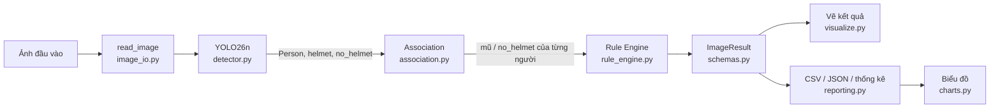

# 2. Kiến trúc hệ thống

## 2.1. Sơ đồ pipeline



Dạng văn bản:

```
Ảnh ──► Detector (YOLO) ──► Association ──► Rule Engine ──► ImageResult
                                                              ├─► ảnh đã vẽ
                                                              ├─► detections / persons / summary.csv
                                                              └─► results.json, biểu đồ
```

## 2.2. Cấu trúc mã nguồn

```
src/helmet_ppe/
├── config.py          Hằng số, enum Status, các dataclass cấu hình (ngưỡng)
├── schemas.py         Kiểu dữ liệu: Detection, HeadEvidence, Association, PersonResult, ImageResult
├── geometry.py        IoU, diện tích giao, tỉ lệ nằm trong, nới hộp
├── image_io.py        Đọc/ghi ảnh an toàn với đường dẫn tiếng Việt, liệt kê ảnh
├── detector.py        HelmetDetector: nạp YOLO một lần, trả về list[Detection]
├── association.py     Ghép mũ / no_helmet với người (chấm điểm + ghép một-một)
├── rule_engine.py     Hệ luật R0–R5 → trạng thái từng người và của ảnh
├── pipeline.py        HelmetPipeline = detector + association + rule engine
├── visualize.py       Vẽ khung, Person ID, trạng thái, độ tin cậy
├── reporting.py       Chuyển kết quả thành dòng CSV, thống kê tổng hợp
├── batch.py           Xử lý thư mục ảnh, ghi toàn bộ đầu ra, xử lý lỗi từng ảnh
├── charts.py          Biểu đồ PNG (matplotlib)
├── cli.py             Giao diện dòng lệnh (python -m helmet_ppe ...)
└── evaluation/
    ├── detection_eval.py  YOLO val: Precision, Recall, mAP50, mAP50-95, confusion matrix
    ├── ground_truth.py    Nhãn chuẩn cấp người (đọc/ghi/suy ra từ nhãn hộp)
    ├── person_eval.py     So sánh kết luận cấp người với nhãn chuẩn
    ├── tuning.py          Dò ngưỡng hệ luật trên tập validation
    └── error_gallery.py   Ảnh minh họa các ca sai
app/streamlit_app.py       Giao diện demo
tests/                     Kiểm thử pytest
scripts/*.bat              Lệnh chạy nhanh trên Windows
```

## 2.3. Mô tả từng module

### Detector (`detector.py`)
* Nạp `models/best.pt` **một lần** khi khởi tạo; kiểm tra mô hình có đủ ba lớp
  `Person`, `helmet`, `no_helmet` (không phân biệt hoa thường), nếu thiếu báo lỗi rõ ràng.
* Chỉ yêu cầu YOLO trả về ba lớp trên (tham số `classes`), đúng phạm vi đề tài.
* Hỗ trợ suy luận theo lô (`detect_batch`) để tăng tốc khi xử lý nhiều ảnh.
* Đầu ra: danh sách `Detection(det_id, class_id, class_name, confidence, bbox)`
  sắp theo confidence giảm dần, `det_id` duy nhất trong ảnh.

### Association (`association.py`)
Ghép mỗi mũ (và mỗi vùng `no_helmet`) với tối đa một người, mỗi người tối đa một
mũ. Chi tiết thuật toán ở [03_methodology.md](03_methodology.md).

### Rule Engine (`rule_engine.py`)
Nhận kết quả ghép, áp dụng bảng luật R0–R5, sinh `PersonResult` gồm trạng thái,
mã luật, lý do bằng tiếng Việt, bằng chứng và cờ cảnh báo (người quá nhỏ, khung
chạm mép trên).

### Pipeline (`pipeline.py`)
`analyze_detections()` là hàm thuần (không cần mô hình) nối association và rule
engine; dùng chung cho pipeline thật, kiểm thử và sinh nhãn chuẩn cấp người.
`HelmetPipeline` bọc thêm detector.

### Batch (`batch.py`)
Đọc ảnh theo lô, mỗi ảnh lỗi được ghi vào `errors.csv` mà không dừng cả quá
trình (nếu cả lô lỗi khi suy luận, hệ thống thử lại từng ảnh để cô lập ảnh hỏng).
Ảnh kết quả ghi vào thư mục riêng, không bao giờ ghi đè ảnh nguồn.

## 2.4. Luồng dữ liệu và tính nhất quán

* Một `ImageResult` là nguồn dữ liệu duy nhất cho mọi đầu ra của ảnh đó:
  ảnh vẽ, ba tệp CSV và `results.json` đều được sinh từ cùng một đối tượng.
* Khóa duy nhất: `(image_name, det_id)` cho detection, `(image_name, person_id)`
  cho người. Mỗi người xuất hiện đúng một dòng trong `persons.csv`, vì vậy các
  thống kê cộng dồn không đếm trùng.
* `person_id` được đánh số 1, 2, 3… theo thứ tự từ trái sang phải trong ảnh,
  khớp với nhãn `P1`, `P2`… trên ảnh đã vẽ.
* Cột `role` trong `detections.csv` cho biết mỗi hộp là `person`,
  `helmet_of_person`, `no_helmet_of_person` hay `unmatched` (không thuộc ai), và
  `assigned_person_id` cho biết thuộc người nào.
