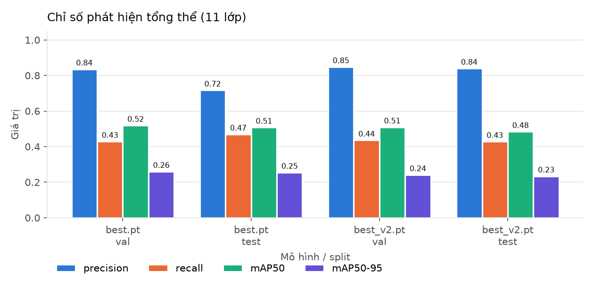
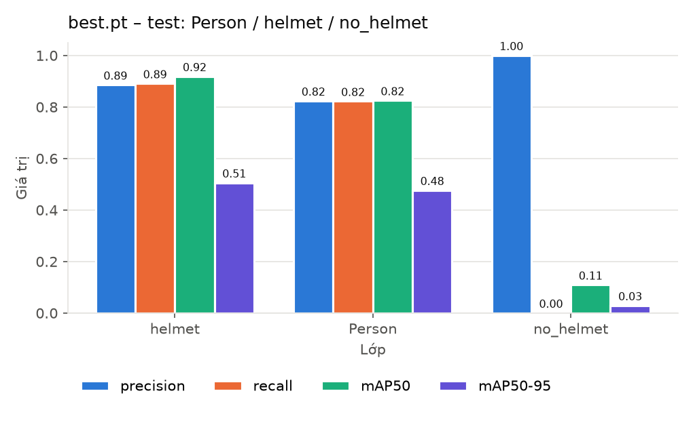
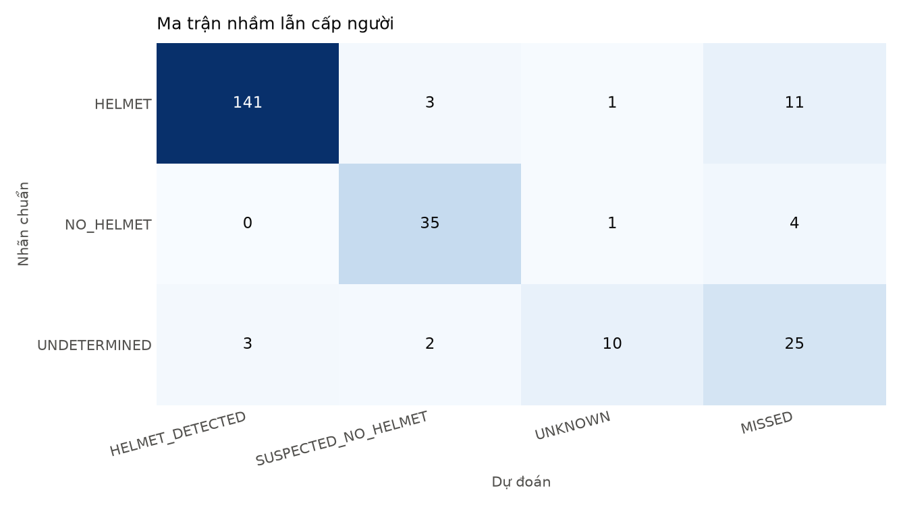
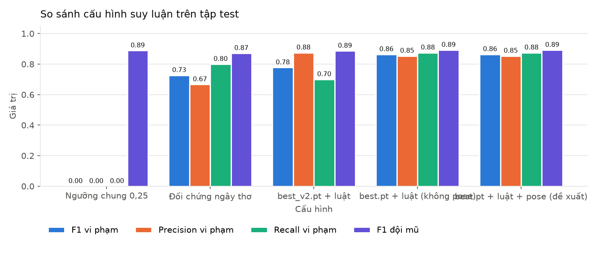
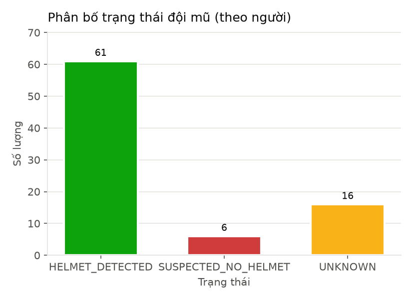

# 6. Kết quả thực nghiệm

Mọi con số dưới đây được sinh tự động bởi `scripts\run_all.bat` (lần chạy cuối
ngày 21/10/2026, Intel Core Ultra 7 155H, chỉ CPU) và có thể kiểm tra lại trong
các tệp được dẫn nguồn. Hình minh họa nằm trong `docs/figures/`.

## 6.1. Đánh giá phát hiện của YOLO (E2)

Nguồn: `reports/detection_eval/overall_metrics.csv`, `per_class_*.csv`.

### Tổng thể (trung bình 11 lớp)

| Mô hình | Split | Ảnh | Precision | Recall | mAP50 | mAP50-95 | Suy luận (ms/ảnh) |
|---|---|---|---|---|---|---|---|
| **best.pt** | val | 143 | 0,836 | 0,429 | **0,519** | **0,260** | 42,4 |
| **best.pt** | test | 141 | 0,717 | 0,469 | **0,508** | **0,255** | 44,0 |
| best_v2.pt | val | 143 | 0,849 | 0,436 | 0,510 | 0,241 | 45,0 |
| best_v2.pt | test | 141 | 0,840 | 0,428 | 0,484 | 0,234 | 44,0 |

### Ba lớp hệ thống sử dụng — `best.pt`

| Lớp | Split | Số hộp | Precision | Recall | mAP50 | mAP50-95 |
|---|---|---|---|---|---|---|
| helmet | val | 201 | 0,872 | 0,791 | 0,822 | 0,442 |
| helmet | **test** | 192 | 0,886 | 0,891 | **0,919** | 0,506 |
| Person | val | 239 | 0,853 | 0,871 | 0,909 | 0,522 |
| Person | **test** | 236 | 0,823 | 0,822 | **0,825** | 0,476 |
| no_helmet | val | 45 | (1,000) | 0,000 | 0,186 | 0,058 |
| no_helmet | **test** | 40 | (1,000) | 0,000 | **0,109** | 0,029 |

**Nhận xét**

* Mô hình phát hiện **mũ** và **người** tốt (mAP50 test 0,92 và 0,83). Đây là hai
  lớp nền tảng của hệ thống.
* Lớp **no_helmet rất yếu** (mAP50 test 0,11). Ultralytics báo Precision/Recall
  ở ngưỡng confidence làm F1 lớn nhất; với lớp này điểm đó cho recall = 0 nên
  precision 1,000 là giá trị suy biến (không có dự đoán nào), không có ý nghĩa.
  Nguyên nhân chính: lớp hiếm (400 hộp train so với 1.357 helmet) nên mô hình cho
  confidence rất thấp. Đây là phát hiện quan trọng nhất dẫn tới việc dùng ngưỡng
  riêng theo lớp (mục 6.2).
* mAP tổng thể chỉ ~0,51 vì bị kéo xuống bởi các lớp `no_*` (đều < 0,15) — các
  lớp này nằm ngoài phạm vi đề tài.
* `best.pt` tốt hơn `best_v2.pt` ở mAP50 và mAP50-95 trên cả val và test, nên
  được chọn làm mô hình chính.
* Confusion matrix và đường PR đầy đủ: `figures/detection_confusion_test.png`,
  `figures/detection_pr_curve_test.png`.

## 6.2. Dò ngưỡng trên tập validation (E3)

Nguồn: `reports/rule_tuning/<model>/rule_sweep.csv` (1.792 tổ hợp mỗi mô hình),
`best_params.json`.

| Tham số | best.pt | best_v2.pt |
|---|---|---|
| `conf_person` | 0,40 | 0,30 |
| `conf_helmet` | 0,25 | 0,20 |
| `conf_no_helmet` | **0,03** | 0,02 |
| Ngưỡng bằng chứng mũ / không-mũ | 0,10 / 0,02 | 0,10 / 0,02 |
| Biên δ | 0 | 0 |
| *Trên val:* F1 vi phạm / F1 đội mũ | 0,933 / 0,875 | 0,967 / 0,833 |

Các giá trị của `best.pt` chính là giá trị mặc định trong `src/helmet_ppe/config.py`
(có test tự động `test_default_thresholds_match_validation_tuning` kiểm tra).

Ở ngưỡng `no_helmet` = 0,03, YOLO trả về 319 hộp `no_helmet` trên tập test nhưng
chỉ 43 hộp ghép được vào vùng đầu của một người — **bước association loại 87%
hộp nhiễu**, nhờ đó dùng được ngưỡng thấp mà không báo vi phạm tràn lan.

## 6.3. Đánh giá suy luận cấp người trên tập test (E4)

Nguồn: `reports/rule_eval/best/rule_metrics.json`, `error_cases.csv`.
Nhãn chuẩn: 236 người (156 HELMET, 40 NO_HELMET, 40 UNDETERMINED); ghép theo IoU ≥ 0,5.

| Chỉ số | Giá trị |
|---|---|
| Người dự đoán / khớp được với nhãn chuẩn | 227 / 193 |
| Người chuẩn bị bỏ sót (MISSED) | 43 (24 trong số đó là UNDETERMINED) |
| Người dự đoán không khớp ai (false person) | 34 |
| **Vi phạm** – Precision / Recall / F1 | **0,805 / 0,825 / 0,815** (TP 33, FP 8, FN 7) |
| **Đội mũ** – Precision / Recall / F1 | **0,868 / 0,885 / 0,876** (TP 138, FP 21, FN 18) |
| Tỉ lệ UNKNOWN (trên người khớp được) | 6,7% |
| Độ chính xác khi đã quyết định (HELMET/NO_HELMET) | 98,3% (171/174) |

Ma trận nhầm lẫn (hàng = nhãn chuẩn, cột = dự đoán):

| | HELMET_DETECTED | SUSPECTED_NO_HELMET | UNKNOWN | MISSED |
|---|---|---|---|---|
| **HELMET** (156) | **138** | 3 | 2 | 13 |
| **NO_HELMET** (40) | 0 | **33** | 1 | 6 |
| **UNDETERMINED** (40) | 4 | 2 | 10 | 24 |

**Nhận xét**

* Khi hệ thống đã đưa ra kết luận, gần như luôn đúng (98,3%); không có người
  không đội mũ nào bị kết luận là đội mũ.
* Phần lớn sai số đến từ **bước phát hiện người** (43 bỏ sót, 34 thừa) chứ không
  từ hệ luật.
* Độ nhạy theo ngưỡng ghép người: với IoU ≥ 0,3 (`reports/rule_eval/best_iou03/`)
  F1 vi phạm tăng lên 0,875 và F1 đội mũ 0,885 — cho thấy một phần "lỗi" chỉ là
  khung người dự đoán và khung chuẩn lệch nhau (mục 6.5).

## 6.4. So sánh cấu hình (ablation) trên tập test

Cùng tập test, cùng nhãn chuẩn. Nguồn: `reports/rule_eval/comparison/comparison.csv`.

| Cấu hình | P vi phạm | R vi phạm | F1 vi phạm | F1 đội mũ | UNKNOWN |
|---|---|---|---|---|---|
| `best.pt`, ngưỡng chung 0,25 (chưa dò) | không xác định | **0,000** | không xác định | 0,873 | 27,3% |
| Đối chứng ngây thơ: "không thấy mũ = vi phạm" | 0,667 | 0,800 | 0,727 | 0,872 | 0% |
| `best_v2.pt` + association + hệ luật (ngưỡng dò riêng) | 0,813 | 0,650 | 0,722 | 0,867 | 11,5% |
| **`best.pt` + association + hệ luật (đề xuất)** | **0,805** | **0,825** | **0,815** | **0,876** | 6,7% |

**Nhận xét**

* **Ngưỡng chung 0,25 không phát hiện được vi phạm nào** (recall 0): toàn bộ 34
  người không đội mũ được khớp đều rơi vào UNKNOWN. Cấu hình này "an toàn" nhưng
  vô dụng cho mục tiêu giám sát.
* **Đối chứng ngây thơ** đạt recall cao nhưng **báo nhầm gấp đôi** (16 FP so với 8),
  trong đó 12 người UNDETERMINED (không đủ thông tin) bị gán là vi phạm. Hệ luật
  thận trọng giảm số báo nhầm này xuống 2 → precision tăng từ 0,667 lên 0,805.
* Với cùng quy trình, `best.pt` vượt `best_v2.pt` rõ rệt ở recall vi phạm (0,825
  so với 0,650) dù `best_v2` tốt hơn trên val → nhắc lại rủi ro chọn tham số trên
  tập nhỏ (45 người vi phạm ở val).

## 6.5. Phân tích lỗi

Ảnh minh họa: `reports/rule_eval/best/error_examples/<loại lỗi>/` (khung trắng =
nhãn chuẩn, khung màu = dự đoán).

| Loại lỗi | Số ca | Nguyên nhân chính |
|---|---|---|
| MISSED_PERSON | 43 | Người nhỏ/hậu cảnh (24 ca UNDETERMINED); khung người chuẩn bao nhiều người hoặc lệch so với khung dự đoán (IoU < 0,5) |
| FALSE_PERSON | 34 | Phần lớn là cùng một người nhưng khung dự đoán (toàn thân) lệch khung chuẩn (nửa thân) → không đạt IoU 0,5; số còn lại là phát hiện thừa |
| FALSE_VIOLATION | 3 | Cả 3 trong một ảnh (`image1354`): người đi xe đạp đội **mũ bảo hiểm xe đạp** (nhãn chuẩn là helmet) — mô hình không nhận ra mũ, chỉ thấy no_helmet yếu |
| DECIDED_ON_UNDETERMINED | 6 | Nhãn chuẩn không có hộp đầu, hệ thống vẫn kết luận (4 đội mũ, 2 vi phạm) — thường do nhãn chuẩn thiếu |
| HELMET_AS_UNKNOWN | 2 | Mũ không được phát hiện hoặc nằm ngoài vùng đầu |
| VIOLATION_AS_UNKNOWN | 1 | Không có hộp no_helmet đủ gần đầu |

**Ca thất bại tiêu biểu**

* `figures/error_false_violation.jpg` — mũ xe đạp, ảnh tối: lỗi miền dữ liệu.
* `figures/error_box_mismatch.jpg` — các cầu thủ bóng chuyền không đội mũ được
  kết luận đúng là `NO HELMET?`, nhưng khung người dự đoán khác hẳn khung chuẩn nên
  bị tính là FALSE_PERSON + MISSED_PERSON: giới hạn của nhãn chuẩn, không phải lỗi
  suy luận.
* `figures/error_missed_person.jpg` — công nhân cúi người chồng lấn nhau.

**Ca thành công tiêu biểu**

* `figures/example_all_helmets.jpg` — 5 người đứng sát nhau, mỗi mũ được ghép đúng
  người (đường nối mũ ↔ người), cả 5 `HELMET`.
* `figures/example_no_helmet.jpg` — 3 cầu thủ bóng đá không đội mũ, cả 3
  `NO HELMET?` dù confidence `no_helmet` chỉ 0,03–0,16 (association lọc nhiễu).

## 6.6. Xử lý hàng loạt ảnh trong `data/raw` (E5)

Nguồn: `outputs/experiment_01/` (29 ảnh, ngưỡng mặc định).

| Chỉ số | Giá trị |
|---|---|
| Ảnh xử lý thành công / lỗi | 29 / 0 |
| Người phát hiện | 73 |
| Hộp mũ / hộp no_helmet | 79 / 43 |
| HELMET_DETECTED / SUSPECTED_NO_HELMET / UNKNOWN | 63 / 4 / 6 |
| Trạng thái ảnh: đủ mũ / có nghi vi phạm / chưa rõ | 22 / 2 / 5 |
| Mũ không thuộc người nào | 16 |
| Tổng thời gian / trung bình | 2,8 s / 97 ms mỗi ảnh (gồm đọc ảnh, vẽ, ghi tệp; riêng suy luận YOLO 34,9 ms) |

> ⚠️ **Lưu ý trung thực:** `scripts/find_dataset_duplicates.py` cho thấy **cả 29 ảnh
> trong `data/raw` đều là bản sao ảnh của Construction-PPE** (20 ảnh thuộc test,
> 4 ảnh val, 5 ảnh train — `anh_ct (10)`, `(23)`–`(26)` thuộc tập huấn luyện).
> Vì vậy E5 chỉ minh họa khả năng xử lý hàng loạt, **không** phải đánh giá trên dữ
> liệu thực tế độc lập, và không tính độ chính xác cho tập này. Để đánh giá trên
> ảnh công trường thật, cần thu thập ảnh mới và gán nhãn cấp người (định dạng CSV ở
> README mục 5).

Trên tập test (141 ảnh) thời gian xử lý trung bình là 73 ms/ảnh (10,3 s tổng),
trong đó suy luận YOLO 43,6 ms.

## 6.7. Kiểm thử phần mềm (E1, E6)

| Hạng mục | Kết quả |
|---|---|
| pytest | **53/53 passed** (`logs/pytest.log`) |
| Import toàn bộ module | OK (`logs/imports.log`) |
| Một ảnh (`predict`) | OK (`outputs/single/`) |
| Batch 29 ảnh | OK, 0 lỗi |
| Đánh giá (9 bước) | Tất cả exit code 0 (`logs/evaluation.log`) |
| Kiểm tra ảnh trùng lặp | OK (`logs/duplicates.log`) |
| Gom 18 hình vào `docs/figures/` | OK (`logs/collect_figures.log`) |
| Streamlit | AppTest chạy toàn bộ script không lỗi; server trả lời `/_stcore/health` = ok |
