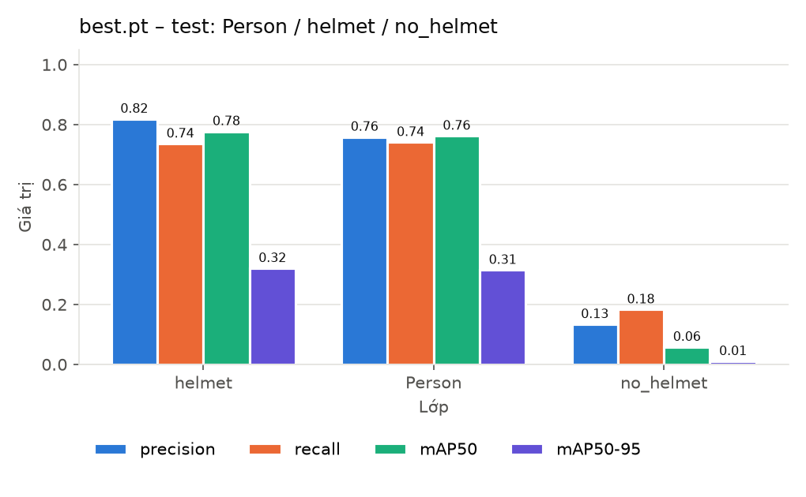
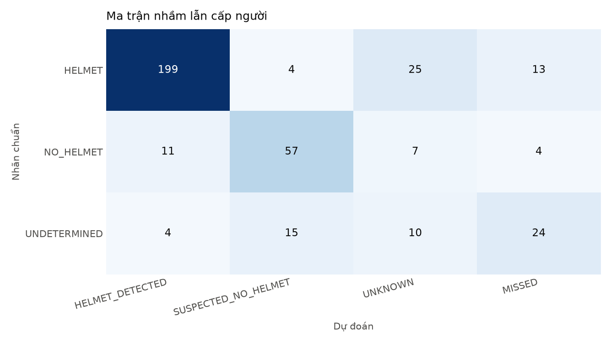
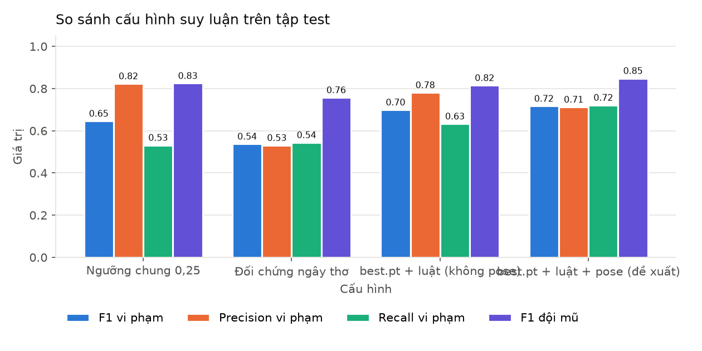
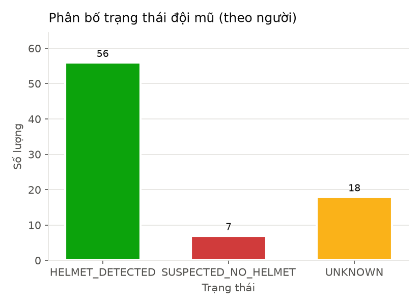

# 6. Kết quả thực nghiệm

Mọi con số dưới đây được sinh tự động bởi `scripts\run_evaluation.bat` và các lệnh trong `scripts\run_all.bat`
(lần chạy cuối ngày 15/11/2026, Intel Core Ultra 7 155H, chỉ CPU) và có thể kiểm tra lại trong các tệp được dẫn
nguồn. Mô hình chính là **`models/best.pt` (YOLO26n)** kết hợp **`models/yolo26n-pose.pt`** (hỗ trợ). Hình minh họa
nằm trong `docs/figures/`. Tập đánh giá là `data/ppe-eval` (val 270 ảnh, test 255 ảnh), **không có ảnh nào trùng với
dữ liệu huấn luyện** (mục 4.1).

## 6.1. Đánh giá phát hiện của YOLO (E2)

Nguồn: `reports/detection_eval/per_class_best_{val,test}.csv`.

### Quá trình huấn luyện (trên tập val của bộ huấn luyện, 230 ảnh)

YOLO26n huấn luyện 75 epoch (dừng sớm, tốt nhất ở epoch 73; 22 phút trên GPU T4). Ở epoch tốt nhất: Precision 0,860,
Recall 0,773, mAP50 **0,819**, mAP50-95 **0,597** (trung bình các lớp). Trên lớp hệ thống dùng: `helmet`
mAP50 0,995; `no_helmet` mAP50 0,901 (`reports/training/yolo26n/`, `colab_run_output.ipynb`).

### Trên tập đánh giá độc lập (ba lớp hệ thống sử dụng)

| Lớp | Split | Số hộp | Precision | Recall | mAP50 | mAP50-95 |
|---|---|---|---|---|---|---|
| helmet | val | 344 | 0,723 | 0,570 | 0,611 | 0,243 |
| helmet | **test** | 284 | 0,819 | 0,736 | **0,777** | 0,321 |
| Person | val | 432 | 0,826 | 0,676 | 0,735 | 0,271 |
| Person | **test** | 373 | 0,759 | 0,741 | **0,762** | 0,315 |
| no_helmet | val | 96 | 0,239 | 0,198 | 0,078 | 0,014 |
| no_helmet | **test** | 82 | 0,134 | 0,183 | **0,058** | 0,010 |
| *Trung bình 3 lớp* | val / test | | | | *0,475 / 0,532* | |

(Số "all" của Ultralytics trung bình trên cả 11 lớp, trong đó có các lớp không xuất hiện ở bộ đánh giá nên bị kéo
xuống; báo cáo này chỉ dùng số của ba lớp ở trên.)

**Nhận xét**

* Mô hình phát hiện **mũ** và **người** khá tốt trên ảnh chưa từng thấy (mAP50 test 0,78 và 0,76).
* Lớp **no_helmet rất yếu trên bộ đánh giá** (mAP50 test 0,058) dù đạt 0,90 trên val của chính bộ huấn luyện. Khoảng
  cách này cho thấy mô hình không tổng quát hóa được lớp `no_helmet` sang bộ ảnh khác: cảnh, góc chụp và cách gán
  nhãn "đầu trần" khác nhau giữa hai phiên bản. Chúng tôi chưa kiểm chứng riêng nguyên nhân (chênh lệch cách gán nhãn
  hay chênh lệch cảnh); đây là phát hiện quan trọng nhất và dẫn tới việc hệ luật phải dựa vào ngưỡng thấp theo lớp
  (mục 6.2).
* Đây là điểm khác so với đánh giá trên cùng bộ dữ liệu: mô hình chỉ thấy bản 11/2026 khi huấn luyện, nên điểm trên
  test phản ánh khả năng áp dụng sang dữ liệu mới.
* Confusion matrix và đường PR đầy đủ: `figures/detection_confusion_test.png`, `figures/detection_pr_curve_test.png`.

## 6.2. Dò ngưỡng trên tập validation (E3)

Nguồn: `reports/rule_tuning/best/rule_sweep.csv` (5.184 tổ hợp), `best_params.json`.

| Tham số | Giá trị đã dò (bật pose) |
|---|---|
| `conf_person` | 0,50 |
| `conf_helmet` | 0,20 |
| `conf_no_helmet` | **0,05** |
| `conf_pose_person` | 0,40 |
| Ngưỡng bằng chứng mũ / không-mũ | 0,10 / 0,05 |
| Biên δ | 0 |
| Dung sai đầu (x, y), tỉ lệ kích thước đầu tối thiểu | 1,2 · 0,8 · 0,8 |
| *Trên val:* F1 vi phạm / F1 đội mũ | 0,791 / 0,783 |

Các giá trị này chính là mặc định trong `src/helmet_ppe/config.py` (test tự động
`test_default_thresholds_match_validation_tuning` kiểm tra). Ngưỡng `no_helmet` thấp (0,05) cho phép hệ luật có
bằng chứng vi phạm dù mô hình ít tự tin, còn bước ghép với vùng đầu lọc bớt hộp nhiễu.

## 6.3. Đánh giá suy luận cấp người trên tập test (E4)

Nguồn: `reports/rule_eval/best/rule_metrics.json`, `error_cases.csv`. Nhãn chuẩn: 373 người (241 HELMET,
79 NO_HELMET, 53 UNDETERMINED); ghép theo IoU ≥ 0,5.

| Chỉ số | Giá trị |
|---|---|
| Người dự đoán / khớp được với nhãn chuẩn | 410 / 332 |
| Người chuẩn bị bỏ sót (MISSED) | 41 |
| Người dự đoán không khớp ai (false person) | 78 |
| **Vi phạm** – Precision / Recall / F1 | **0,713 / 0,722 / 0,717** (TP 57, FP 23, FN 22) |
| **Đội mũ** – Precision / Recall / F1 | **0,873 / 0,826 / 0,849** (TP 199, FP 29, FN 42) |
| Tỉ lệ UNKNOWN (trên người khớp được) | 12,7% |
| Độ chính xác khi đã quyết định (HELMET/NO_HELMET) | 94,5% |

Ma trận nhầm lẫn (hàng = nhãn chuẩn, cột = dự đoán):

| | HELMET_DETECTED | SUSPECTED_NO_HELMET | UNKNOWN | MISSED |
|---|---|---|---|---|
| **HELMET** (241) | **199** | 4 | 25 | 13 |
| **NO_HELMET** (79) | 11 | **57** | 7 | 4 |
| **UNDETERMINED** (53) | 4 | 15 | 10 | 24 |

**Nhận xét**

* Hệ luật giữ được F1 vi phạm 0,72 dù mô hình phát hiện `no_helmet` rất yếu (mAP50 0,058): ghép hộp với vùng đầu
  của từng người và ngưỡng theo lớp bù lại phần lớn khuyết điểm của bước phát hiện.
* Có 11 người không đội mũ bị kết luận là đội mũ (MISSED_VIOLATION); đây là loại lỗi nghiêm trọng nhất. Nguyên nhân
  từng ca chưa được phân tích chi tiết, nhưng loại lỗi này liên quan trực tiếp đến độ tin cậy thấp của lớp `no_helmet`.
* Phần lớn sai số cấp người đến từ **bước phát hiện người** (41 bỏ sót, 78 thừa), không chỉ từ hệ luật.
* Độ nhạy theo ngưỡng ghép người: với IoU ≥ 0,3 (`reports/rule_eval/best_iou03/`) F1 vi phạm tăng lên **0,779**
  (P 0,800, R 0,760) và F1 đội mũ giữ 0,849 — một phần "lỗi" chỉ là khung người dự đoán và khung chuẩn lệch nhau (6.5).

## 6.4. So sánh cấu hình (ablation) trên tập test

Cùng tập test, cùng nhãn chuẩn. Nguồn: `reports/rule_eval/comparison/comparison.csv`.

| Cấu hình | P vi phạm | R vi phạm | F1 vi phạm | F1 đội mũ | UNKNOWN |
|---|---|---|---|---|---|
| `best.pt`, ngưỡng chung 0,25 (chưa dò) | 0,824 | 0,532 | 0,646 | 0,825 | 14,1% |
| Đối chứng ngây thơ: "không thấy mũ = vi phạm" | 0,531 | 0,544 | 0,538 | 0,757 | 0% |
| `best.pt` + association + hệ luật, **không pose** | 0,781 | 0,633 | 0,699 | 0,815 | 7,8% |
| **`best.pt` + pose + association + hệ luật (đề xuất)** | **0,713** | **0,722** | **0,717** | **0,849** | 12,7% |

**Nhận xét**

* **Hệ luật đầy đủ vượt luật ngây thơ rõ rệt** (F1 vi phạm 0,717 so với 0,538): luật ngây thơ gán "vi phạm" cho cả người
  không đủ thông tin, nên precision chỉ 0,53.
* **Pose cải thiện recall** (0,633 lên 0,722) và F1 đội mũ (0,815 lên 0,849), đổi lại precision vi phạm giảm
  (0,781 xuống 0,713); F1 vi phạm tăng nhẹ (0,699 lên 0,717). Pose bổ sung người bị che khuất mà YOLO bỏ sót
  (410 người dự đoán so với 337 khi tắt pose).
* Ngưỡng chung 0,25 cho precision cao (0,824) nhưng bỏ sót gần nửa số vi phạm (recall 0,532) vì mô hình ít tự tin ở
  lớp `no_helmet`; việc dò ngưỡng theo lớp tăng recall lên 0,722.
* Do val chỉ có 96 người vi phạm, chênh lệch nhỏ giữa các cấu hình (vài điểm phần trăm) nằm trong khoảng nhiễu của phép đo.

## 6.5. Phân tích lỗi

Ảnh minh họa: `reports/rule_eval/best/error_examples/<loại lỗi>/` (khung trắng = nhãn chuẩn, khung màu = dự đoán).

| Loại lỗi | Số ca | Nguyên nhân chính |
|---|---|---|
| FALSE_PERSON | 78 | Ví dụ: người ở mép ảnh hoặc hậu cảnh không có trong nhãn chuẩn; khung dự đoán lệch khung chuẩn (IoU < 0,5) |
| MISSED_PERSON | 41 | Ví dụ: khung người chuẩn chồng lên nhau hoặc bao nhiều người nên không ghép được với khung dự đoán |
| HELMET_AS_UNKNOWN | 25 | Mũ không được phát hiện hoặc nằm ngoài vùng đầu |
| DECIDED_ON_UNDETERMINED | 19 | Nhãn chuẩn không có hộp đầu cho người này nhưng hệ thống vẫn đưa ra kết luận |
| MISSED_VIOLATION | 11 | Người không đội mũ nhưng bị kết luận là đội mũ |
| VIOLATION_AS_UNKNOWN | 7 | Không có hộp `no_helmet` đủ gần đầu |
| FALSE_VIOLATION | 4 | Hộp `no_helmet` độ tin cậy thấp chồng lên đầu đã đội mũ |

**Ca thất bại tiêu biểu**

* `figures/error_false_violation.jpg` — công nhân ngồi trên giàn giáo đội mũ nhưng mô hình sinh hộp `no_helmet`
  (0,11) ngay trên mũ nên bị kết luận `NO HELMET?` (lỗi miền dữ liệu của lớp `no_helmet`).
* `figures/error_false_person.jpg` — người cắt ở mép trái ảnh không có trong nhãn chuẩn (FALSE_PERSON), và công
  nhân bên phải đội mũ rõ nhưng mũ không được phát hiện nên chỉ ra `UNKNOWN`.
* `figures/error_missed_person.jpg` — nhãn chuẩn có hai khung người chồng lên nhau trong khi mô hình chỉ dự đoán
  một khung; người thứ hai tính là bỏ sót: giới hạn của nhãn chuẩn, không phải lỗi suy luận.

**Ca thành công tiêu biểu**

* `figures/example_all_helmets.jpg` — 4 người cùng ảnh, mỗi mũ được ghép đúng người, cả 4 `HELMET`.
* `figures/example_no_helmet.jpg` — 5 người không đội mũ, cả 5 `NO HELMET?` (association lọc hộp nhiễu).

## 6.6. Xử lý hàng loạt ảnh trong `data/raw` (E5)

Nguồn: `outputs/experiment_01/` (29 ảnh, ngưỡng mặc định).

| Chỉ số | Giá trị |
|---|---|
| Ảnh xử lý thành công / lỗi | 29 / 0 |
| Người phát hiện (nguồn: chỉ pose / chỉ YOLO / cả hai) | 81 (27 / 3 / 51) |
| Hộp mũ / hộp no_helmet | 69 / 20 |
| HELMET_DETECTED / SUSPECTED_NO_HELMET / UNKNOWN | 56 / 7 / 18 |
| Trạng thái ảnh: đủ mũ / có nghi vi phạm / chưa rõ / không có người | 14 / 4 / 9 / 2 |
| Mũ không thuộc người nào | 12 |
| Tổng thời gian / trung bình | 4,7 s / 161 ms mỗi ảnh (gồm đọc ảnh, vẽ, ghi tệp; riêng suy luận YOLO 76,8 ms) |

> **Lưu ý trung thực:** cả 29 ảnh trong `data/raw` trùng ảnh của bộ đánh giá (18 train, 8 val, 3 test; mục 4.6),
> không phải dữ liệu thực tế độc lập, nên E5 chỉ minh họa khả năng xử lý hàng loạt và không tính độ chính xác.
> Để đánh giá trên ảnh công trường thật, cần thu thập ảnh mới và gán nhãn cấp người (định dạng CSV ở README mục 5).

Trên tập test (255 ảnh) suy luận YOLO trung bình 29,9 ms/ảnh (`reports/detection_eval/overall_metrics.csv`).

## 6.7. Kiểm thử phần mềm (E1, E6)

| Hạng mục | Kết quả |
|---|---|
| pytest | **65/65 passed** |
| Import toàn bộ module | OK |
| Một ảnh (`predict`) | OK (`outputs/single/`) |
| Batch 29 ảnh | OK, 0 lỗi |
| Đánh giá (các bước của `run_evaluation.bat`) | Tất cả exit code 0 (`logs/evaluation.log`) |
| Kiểm tra ảnh trùng lặp | OK (`logs/duplicates.log`) |
| Gom 18 hình vào `docs/figures/` | OK (`logs/collect_figures.log`) |
| Streamlit | AppTest chạy toàn bộ script không lỗi; server trả lời `/_stcore/health` = ok |
